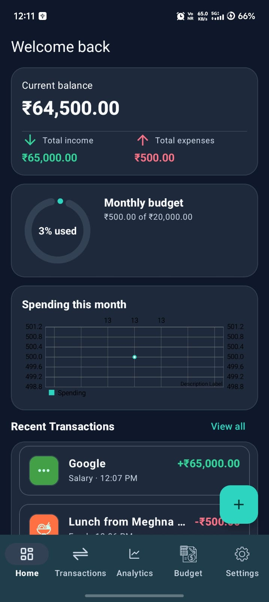
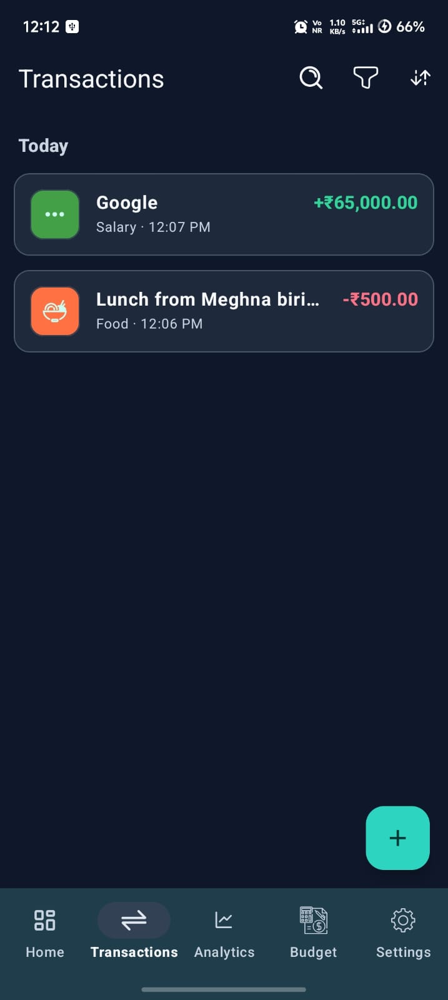
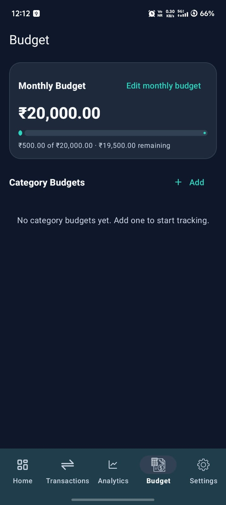
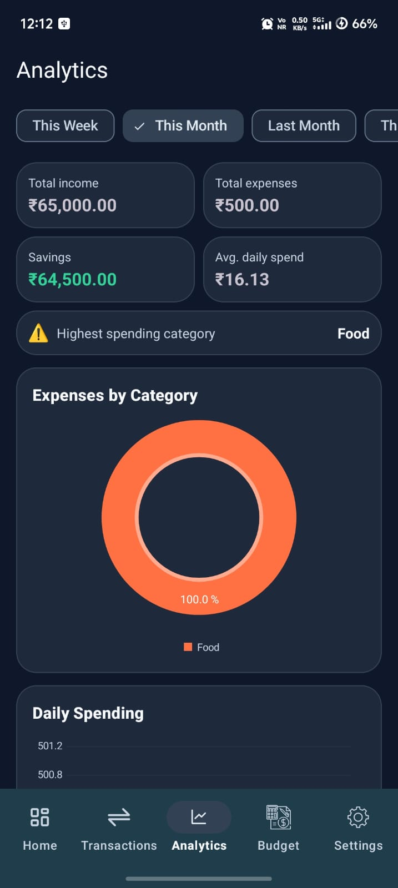
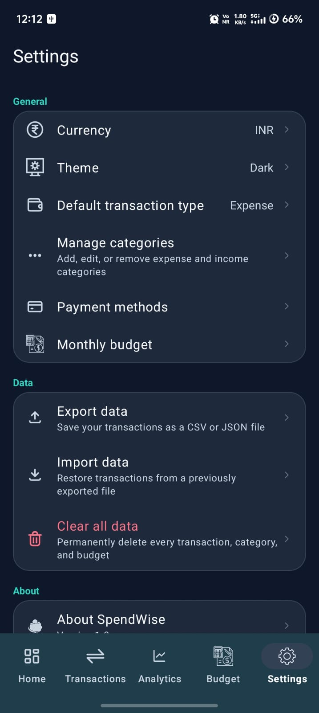

# SpendWise 💰

**SpendWise** is a modern, fully offline Android application designed to help users track day-to-day income and expenses, set category budgets, and analyze spending patterns with insightful charts.
---

## 📲 Download SpendWise

 Try the SpendWise Android app by downloading the APK below.

**[⬇️ Download SpendWise APK](https://github.com/ashoklakshamanan-glitch/MoneyManagement/releases/latest)**

Download the APK on your Android device and install it. You may need to allow installation from your browser or file manager.


---

## ✨ Features

- **Dashboard**: Quick snapshot of current balance, total income, expenses, monthly budget ring, recent transactions, and weekly spending chart.
- **Transaction Tracking**: Add, edit, search, filter, and sort income and expense entries with custom dates, times, payment methods, and notes.
- **Budget Management**: Set an overall monthly budget and per-category budgets with warning alerts when nearing or exceeding limits.
- **Analytics & Insights**: Interactive spending graphs, category breakdown, daily spending trends, and customizable date range statistics.
- **Category Customization**: Create and edit expense and income categories with custom icons and color palettes.
- **Data Export & Import**: Backup and restore financial data locally using CSV or JSON formats.
- **Theme & Preferences**: Dark, Light, and System Default themes, plus multi-currency support (INR ₹, USD $, EUR €, etc.).
- **Privacy First**: Fully offline — your data never leaves your device.

---

## 📱 App Screenshots
<p align="center">
 
</p>
<p align="center">
  
  
  
</p>

<p align="center">
  
  
</p>

## 🛠️ Tech Stack & Architecture

- **Language**: [Kotlin](https://kotlinlang.org/)
- **Architecture**: MVVM (Model-View-ViewModel) + Clean Architecture (Data, Domain, Presentation)
- **UI Framework**: Material Design 3 (Material3), ViewBinding, Navigation Component
- **Database**: [Room](https://developer.android.com/training/data-storage/room) for local persistence
- **Preferences**: [DataStore](https://developer.android.com/topic/libraries/architecture/datastore)
- **Dependency Injection**: [Hilt](https://dagger.dev/hilt/)
- **Asynchronous / Reactive**: Kotlin Coroutines & StateFlow / SharedFlow
- **Charts**: [MPAndroidChart](https://github.com/PhilJay/MPAndroidChart)
- **Crash Reporting & Analytics**: Firebase Crashlytics & Analytics

---

## 📁 Project Structure

```
spendwise/
├── app/
│   ├── src/main/java/com/moneymanagement/spendwise/
│   │   ├── data/           # Room entities, DAOs, repositories & DataStore
│   │   ├── domain/         # Models & repository interfaces
│   │   ├── presentation/   # Fragments, ViewModels, adapters & UI logic
│   │   ├── di/             # Hilt Dependency Injection modules
│   │   └── utils/          # Extensions, formatters & constants
│   └── src/main/res/       # Layouts, drawables, themes, and navigation graph
```

---

## 🚀 Getting Started

### Prerequisites
- **Android Studio**: Ladybug / 2024.2+ or later
- **JDK**: Version 11 or higher
- **Android SDK**: Min SDK 24 (Android 7.0), Target SDK 36

### Build & Run
1. Clone the repository:
   ```bash
   git clone https://github.com/ashoklakshamanan-glitch/MoneyManagement.git
   ```
2. Open the project in **Android Studio**.
3. Sync Gradle project files.
4. Add your `google-services.json` inside the `app/` folder (for Firebase features).
5. Build and run the app on an emulator or Android device.

---

## 📜 License

Distributed under the MIT License.
